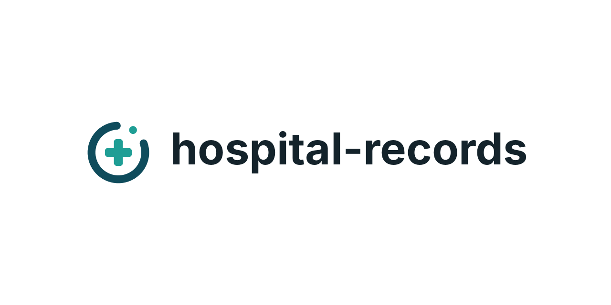

<p align="center">
  
</p>

# Hospital Records

Hospital Records is a medical imaging (DICOM) records platform, at an early stage. It has three parts:

- **FHIR server**: HAPI-FHIR (R4) with Postgres, which stores the clinical records.
- **PACS**: Orthanc with a Postgres index, which stores the DICOM images.
- **Frontend**: an Angular app for creating and managing the FHIR resources.

The frontend works on these FHIR R4 resources:

- **Patients**: list with search, detail page, create, edit, and delete (refused while other
  records still reference the patient). The search looks in names and identifiers (MRN, DICOM
  Patient ID), or in just one of them, matching anywhere in the value and ignoring case. Patients
  created by the PACS sync are identified by their DICOM Patient ID, kept apart from the MRN; one
  without a name is shown by its MRN or DICOM Patient ID. The patient form edits both identifiers:
  giving a patient a DICOM Patient ID links them to the PACS studies with that Patient ID on the
  next sync.
- **Conditions**: shown on the patient page, with detail, create, edit and delete (refused while an
  imaging study names the condition as its reason). Conditions are coded in WHO ICD-10 and/or
  ICD-11, searched through a FHIR terminology server, and the form suggests the matching code in the
  other classification from WHO's official ICD-10 / ICD-11 mapping. Free-text details are stored as
  the condition's first note.
- **Imaging studies**: shown on the patient page, with a detail page and series table. They come
  only from the PACS: the [PACS sync](#pacs-sync) creates them from the DICOM studies in Orthanc,
  and [DICOM import](#dicom-import) uploads files to Orthanc and creates them in one go. There is
  no ImagingStudy without a DICOM study behind it. The one thing the UI edits is a study's
  reasons, which link it to conditions; the link is saved on both sides in a single transaction.
  The study page says where its images are available: the [PACS Endpoint](#the-pacs-endpoint).
- **Endpoints**: their own section (header: _Patients · Endpoints_), with list, detail, create,
  edit and delete (refused while imaging studies point to the endpoint). An endpoint is where
  another system is reached, e.g. the PACS's DICOMweb service: name, status, connection type
  (DICOM WADO-RS / QIDO-RS / STOW-RS, HL7 FHIR), address, payload type and MIME types.

Edits use optimistic locking, so saving over a newer version of a record is refused instead of
silently overwriting it.

## Requirements

- Node.js 24 and npm 11
- Podman with `podman compose` (or Docker Compose) for the local stack
- [DCMTK](https://dicom.offis.de/dcmtk) for `npm run seed:orthanc` (`dnf`/`apt install dcmtk`)

## Getting started

```bash
npm ci                    # install dependencies
cp .env.example .env      # then fill in the three passwords, which have no defaults
podman compose up -d      # start HAPI-FHIR, Orthanc and their Postgres databases
npm run seed              # load sample patients, conditions and the PACS endpoint into HAPI
npm run seed:orthanc      # send the sample DICOM studies to Orthanc (DICOM C-STORE)
npm start                 # dev server at http://localhost:4200
```

Then open the patient list and click **Sync with PACS** to create the patients and imaging studies
of the sample DICOM studies.

HAPI takes a minute or so to start the first time; `npm run seed` fails with a clear message
until it is reachable. The seed uses fixed ids, so running it again resets the sample records
instead of duplicating them.

`npm run seed` also installs the custom search parameters the patient search needs: FHIR's own
`identifier` search only matches whole values, so each kind of patient identifier gets a string
search parameter that matches like a name, anywhere in the value (FHIR's `:contains`, which
HAPI must allow; the compose image does). HAPI reindexes existing patients in the background, so
identifier search can take a minute to find them after the first seed. Any other HAPI the app uses
needs these search parameters too.

`npm run seed:orthanc` sends every `*.dcm` under `scripts/seed/dicom/` to Orthanc's DICOM port
with DCMTK's `dcmsend`. That folder is git-ignored (the samples are about 1.2 GB), so put the
series there first, one folder each. Orthanc ignores instances it already has, so it can be run
again safely.

## PACS sync

The **Sync with PACS** button on the patient list brings FHIR in line with Orthanc. It reads the
PACS through its DICOMweb API (`/dicom-web`, see [Dev server proxy](#dev-server-proxy)) and, for
every DICOM study:

1. finds the Patient by **DICOM Patient ID** (`urn:hospital-records:dicom-patient-id`), or creates
   one from the study. Patients are never matched by MRN: the two often differ, so a patient
   created by hand is not linked to their PACS studies automatically;
2. creates the study's **ImagingStudy**, matched by its Study Instance UID, in the same
   transaction; or, when it exists, updates it from the PACS. Everything that comes from DICOM is
   replaced, and what was added in the app (reasons, notes) is kept.

Running it again is safe: creates are conditional, so nothing is duplicated, and an ImagingStudy
that is unchanged is not written. Afterwards a report lists:

- what was created, updated or left unchanged, and how many patients are new;
- DICOM studies that were **skipped** (no Patient ID, or an ImagingStudy for the same UID already
  belongs to another patient) or **failed**, with the reason;
- ImagingStudies that are **not in the PACS**. These are only reported, never changed or deleted.

The sync runs in the browser and only when someone clicks the button.

## The PACS Endpoint

Imaging studies point to the Endpoint their images are retrieved from (`ImagingStudy.endpoint`),
which a viewer or another system needs to find them. The PACS sync and the DICOM import link each
study to **the PACS Endpoint**: the one **active** Endpoint with connection type **DICOM WADO-RS**.
Its page shows a _PACS endpoint_ badge.

- `npm run seed` creates it for the local Orthanc: `Endpoint/pacs-dicomweb`, at
  `http://localhost:<ORTHANC_HTTP_PORT>/dicom-web`.
- With no such Endpoint, studies are simply not linked. With several, they aren't linked either,
  links already stored are kept, and the sync report says so: turn off all but one.
- Studies synced before the Endpoint existed get it on their next sync, reported once as
  _updated_.

## DICOM import

**Import DICOM** on the patient list uploads DICOM files to the PACS and creates their records:

1. Drop files or folders on the panel, or choose them. Only DICOM files (those with the `DICM`
   marker) are kept; the others, and any `DICOMDIR`, are listed as skipped.
2. The files go to Orthanc with STOW-RS (`POST /dicom-web/studies`), in batches of up to 20 files
   or 50 MB. A file Orthanc refuses is reported with the reason; if Orthanc is down or refuses the
   login, the upload stops and says so.
3. The studies the stored files belong to, and only those, are synced as above: each goes to the
   Patient with its DICOM Patient ID, or to a new patient, and gets its ImagingStudy.

Uploading the same files again is safe: Orthanc keeps instances it already has, and their studies
come back as unchanged. A study that gained images is updated.

## Local stack

`compose.yaml` runs:

| Service      | Purpose                               | Default address                                |
| ------------ | ------------------------------------- | ---------------------------------------------- |
| `hapi-fhir`  | FHIR R4 REST API                      | http://localhost:8080/fhir                     |
| `fhir-db`    | Postgres for HAPI                     | internal only                                  |
| `orthanc`    | PACS: REST API, Explorer UI, DICOMweb | http://localhost:8042 (DICOMweb at /dicom-web) |
| `orthanc`    | DICOM C-STORE / C-FIND / C-MOVE       | port 4242, AE title `HOSPITAL_RECORDS`         |
| `orthanc-db` | Postgres index for Orthanc            | internal only                                  |

Ports are bound to `127.0.0.1` by default. DICOM files themselves stay on the `orthanc-data`
volume; Postgres holds only Orthanc's index.

```bash
podman compose up -d      # start
podman compose logs -f    # follow logs
podman compose down       # stop
podman compose down -v    # stop and wipe all data volumes
```

### Configuration

All settings live in `.env` (git-ignored). `.env.example` lists and explains every key; any key
left out falls back to the default shown there. The main ones:

| Key                                | Used for                                                                                 |
| ---------------------------------- | ---------------------------------------------------------------------------------------- |
| `BIND_ADDRESS`                     | Host interface the published ports listen on                                             |
| `FHIR_HTTP_PORT`                   | HAPI's host port; also used by `ng serve` and `npm run seed`                             |
| `FHIR_DB_PASSWORD`                 | HAPI's Postgres password (required)                                                      |
| `ORTHANC_USER`, `ORTHANC_PASSWORD` | Login for Orthanc's REST API, Explorer UI and the `/dicom-web` proxy (password required) |
| `ORTHANC_DB_PASSWORD`              | Orthanc's Postgres password (required)                                                   |
| `ORTHANC_DICOM_AET`                | AE title other DICOM nodes send to                                                       |
| `TERMINOLOGY_URL`                  | Terminology server for ICD-10 / ICD-11 search                                            |
| `*_IMAGE`                          | Container image versions                                                                 |

Database names, users and passwords only take effect when a volume is first created. After
changing them, recreate the volumes with `podman compose down -v && podman compose up -d`.

### Dev server proxy

`ng serve` proxies three paths (`proxy.conf.mjs`), resolving settings the same way compose does
(shell environment, then `.env`, then defaults):

- `/fhir` goes to the HAPI container.
- `/dicom-web` goes to Orthanc's DICOMweb API. The proxy adds the Orthanc login from
  `ORTHANC_USER` and `ORTHANC_PASSWORD`, so the browser never holds the credentials.
- `/tx` goes to the terminology server. By default this is HL7's public test server
  (`https://tx.fhir.org/r4`), which is fine for development only; set `TERMINOLOGY_URL` to use
  your own.

In deployment nginx will do the same job.

## Commands

```bash
npm start                 # ng serve, dev server at http://localhost:4200
npm run build             # production build to dist/
npm run watch             # development build in watch mode
npm test                  # unit tests (Vitest + jsdom)
npm run lint              # ESLint
npx prettier --write .    # format
npm run seed              # load or reset the sample data in HAPI
npm run icd:maps -- <dir> # regenerate the ICD-10 / ICD-11 mapping tables (see below)
```

Run a single spec file with `npx ng test --include src/app/shared/header/header.spec.ts`.

The production build enforces size budgets: 500 kB warning / 1 MB error for the initial bundle,
and 4 kB warning / 8 kB error per component stylesheet.

### ICD-10 / ICD-11 mapping tables

`public/terminology/icd10-to-icd11.json` and `icd11-to-icd10.json` are generated from WHO's
"MapToOneCategory" tables (currently release 2026-01). To update them, download and unzip
`mapping.zip` of an ICD-11 release, then point the script at the folder:

```bash
curl -O https://icdcdn.who.int/static/releasefiles/2026-01/mapping.zip && unzip mapping.zip -d mapping
npm run icd:maps -- mapping
```

The tables are (c) WHO, licensed CC BY-ND 3.0 IGO.

## Project layout

```
src/app/
  fhir/
    client/          generic FHIR REST client and error messages
    datatypes/       pipes and components for FHIR datatypes (names, dates, codes, references)
    terminology/     terminology client and code search
    resources/       one folder per resource (patient, condition, imaging-study, endpoint):
                     mapper, summary, detail and form components; imaging-study also
                     holds the DICOM → FHIR mapper
    delete-panel/    shared delete panel; refuses while other records still link here
  pacs/              DICOMweb client (QIDO-RS search, STOW-RS upload), the PACS → FHIR sync,
                     and DICOM file checks for the import
  pages/             routed screens; they fetch data and compose resource components
  shared/            app layout: header (with the section links), icons, theme, form helpers
public/terminology/  generated ICD-10 / ICD-11 mapping tables
scripts/
  seed/              seed bundle and loader for HAPI (seed.mjs, with the search parameters and
                     the PACS endpoint), and the DICOM sender for Orthanc (seed-orthanc.mjs)
    dicom/           sample DICOM series, one folder each (git-ignored)
  icd-maps/          converter for WHO's mapping tables
compose.yaml         local development stack
```
